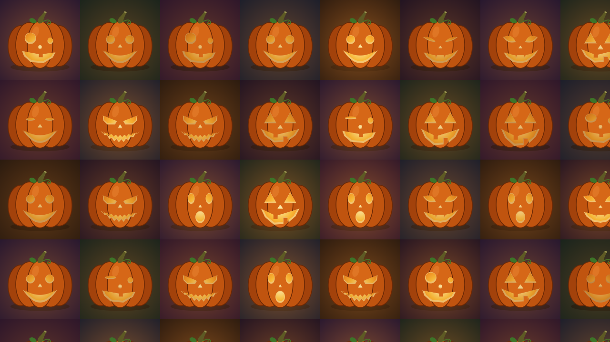
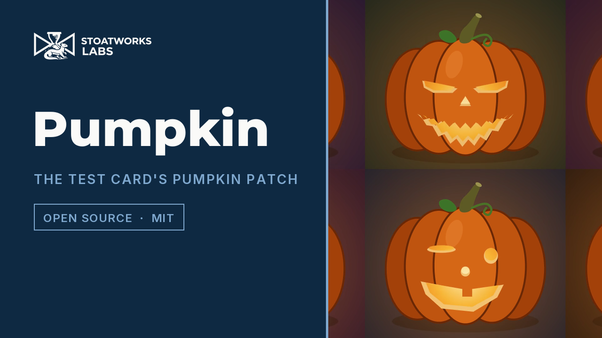

# pumpkin

> **AI-assisted project.** This codebase was created with [Claude](https://claude.com/claude-code)
> (Anthropic), directed and reviewed by a human author. It has **never been loaded into
> Resolume on macOS**; there it is loaded by [oxbow](https://github.com/stoatworks-labs/oxbow),
> a real FFGL host that is not Resolume. On Windows it loads and renders in Resolume Arena
> 7.27.1 under software rendering (see Status). Everything
> below is measured by an offline harness that drives the real plugin class in a headless
> GL context, on this Mac's GPU and again on Apple's software renderer. `pktest --port`
> holds the plugin's port to the numbers the Test Card's own TypeScript prints: **every
> hash and every face on 450 tiles over five seeds and three grids agree exactly**, and
> every point of every face at four expressions, every candle and every blink, out to ten
> years of running, agree to 1e-16. `pktest --testcard` holds the picture to seven pictures
> the Test Card's own painter drew in Chrome: **a mean difference of 0.24 to 0.81 code
> values**, the rest at the edges, where no two rasterisers agree. `pktest --negative`
> re-runs the checks against fourteen deliberately wrong models, and `tools/mutate.sh`
> changes one character of the shipped shaders and code eight times; every one is caught.
> A control sweep fails if any parameter does nothing.

The [Test Card](https://github.com/stoatworks-labs/test-card)'s **Pumpkin patch** for
Resolume Arena/Avenue, as an FFGL source: **SW Pumpkin**, a jack-o'-lantern on every LED
tile, each carved with one of six faces, its candle flickering and its face blinking,
winking or chomping in its own time.

The defaults at 1280 x 720, 21.6 seconds in: the test card's 168-pixel LED tiles,
Seed 1, every face. Rendered by the plugin's offline harness (`pktest`), not captured
from Resolume.

<!-- downloads:start -->

## Download

**[v0.1.0](https://github.com/stoatworks-labs/pumpkin/releases/tag/v0.1.0)** — prebuilt for macOS and Windows. Pick your platform:

<b>macOS</b> — Universal (Apple Silicon + Intel)

| Build | Download | Size |
| --- | --- | --- |
| Universal (Apple Silicon + Intel) · .dmg disk image | [`pumpkin-0.1.0-macos-universal.dmg`](https://github.com/stoatworks-labs/pumpkin/releases/download/v0.1.0/pumpkin-0.1.0-macos-universal.dmg) | 248 KB |
| Universal (Apple Silicon + Intel) · .zip archive | [`pumpkin-macos-universal.zip`](https://github.com/stoatworks-labs/pumpkin/releases/latest/download/pumpkin-macos-universal.zip) | 211 KB |

<b>Windows</b> — x64

| Build | Download | Size |
| --- | --- | --- |
| x64 · .exe installer | [`pumpkin-0.1.0-windows-x86_64-setup.exe`](https://github.com/stoatworks-labs/pumpkin/releases/download/v0.1.0/pumpkin-0.1.0-windows-x86_64-setup.exe) | 232 KB |
| x64 · .zip archive | [`pumpkin-windows-x86_64.zip`](https://github.com/stoatworks-labs/pumpkin/releases/latest/download/pumpkin-windows-x86_64.zip) | 129 KB |

All builds, checksums and release notes: [github.com/stoatworks-labs/pumpkin/releases](https://github.com/stoatworks-labs/pumpkin/releases).

macOS builds are signed and notarised and open normally. The Windows builds are unsigned, so SmartScreen warns once.

<!-- downloads:end -->

## Video

## The one idea

**It is not a pumpkin like the test card's. It is the test card's pumpkin.** The
lantern, its six faces and their expressions, the candle flicker, which face goes on
which tile and each tile's night are the test card's code, ported line for line, and
the harness checks the port against the test card itself rather than against
anyone's memory of what a pumpkin looks like. So:

- **Same tiles, same seed, same patch.** A tile's face is chosen from where the tile
  sits on the surface, exactly as the test card chooses it, so Seed 1 on 168-pixel
  tiles here is Seed 1 on 168-pixel tiles there (on a spanned surface; see the note
  under Controls).
- **Same candles.** Each candle is three flickers at about 1.3, 3.1 and 5.3 Hz, each
  its own; each face blinks, winks, chomps, squints or gasps every two and a half to
  four seconds, at a time of its own. With **Clock** set to **Wall**, the time is the test
  card's own live clock, so a pumpkin in Resolume flickers in step with the same
  pumpkin on a test card output, on machines whose clocks agree.
- **Same drawing.** The six faces are the test card's: classic, fierce, happy,
  surprised, sly (with fangs) and goofy. Untick them all and you get plain pumpkins,
  uncarved and unlit, which is a look.

The six faces on 320 x 270 tiles, Seed 69, 2.2 seconds in. Top: classic, surprised
(mid-gasp) and sly; bottom: happy, goofy and fierce (mid-squint, teeth set). Rendered by
`pktest`.

## Controls

- **Patch:** Tile Width and Tile Height (16–4096 pixels; 168, the test card's default
  LED tile), Origin X and Origin Y (where the tile grid starts, in pixels), Seed
  (0–9999: which face goes where).
- **Faces:** Classic, Fierce, Happy, Surprised, Sly, Goofy. Untick a face and the patch
  is dealt again from the rest: its tiles get other faces, and some of the other tiles
  change too, as on the test card. Untick all six and the pumpkins are plain.
- **Candles:** Flicker (off: a steady candle, as the test card's), Expressions (blinks,
  winks and chomps), Speed (still at the bottom, then a quarter to four times the test
  card's pace, 1x in the middle), Clock (*Resolume*: the clip's time, times Speed;
  *Wall*: the test card's live clock, seconds since 1 January 2026 by this machine's
  clock, which Speed does not touch).
- **Look:** Background (*Night*: each tile its own night sky, as the test card draws
  them, each glow stopping at its tile's edge; *Dark*: one night for every tile, the
  glows running on across the tiles' edges, so the grid disappears; *None*: transparent,
  just the pumpkins, their glow and their shadows, to lay over the composition below.
  The glows overlap, so a carved patch tints the whole clip a little; plain pumpkins
  leave it clear).

The test card keys a tile on its place on the surface **and**, unless the outputs are
spanned, on which output it is, so that six identical projectors do not all get the
same patch. This plugin has one surface, so it matches the test card's **spanned**
patch; an unspanned test card output deals its own.

## Status

**v0.1.0, 27 October 2026: the first release, and early days.** There's a
[user guide](https://stoatworks-labs.com/software/pumpkin/guide/)
([PDF](docs/USER-GUIDE.pdf)) and a [project page](https://stoatworks-labs.com/software/pumpkin/);
no presets, no OpenFX port and no browser demo.

- **Verified** (`tools/verify.sh`, all green): the port against the test card's own
  numbers and pictures (above); that every face's movement is linear, which is what
  lets the shader store each point twice and mix (`--linear`); that the shader's
  ellipses and flattened curves are within 0.1 px of the curves the canvas draws, for a
  pumpkin 4096 px wide (`--smoothing`); each tile's night by column and row, and the
  patch unchanged when the grid moves a whole tile (`--tiles`); Resolume's clock at 499
  million milliseconds kept in double, Speed, scrubs and the Wall clock (`--clock`);
  steady candles and still faces not moving, plain pumpkins unlit, Background None
  transparent and premultiplied (`--still`); a resized instance painting what a fresh
  one would (`--resize`).
- **On Windows**, the fleet's Arena gate (9 of 9 passed): it loads, registers and renders in Resolume Arena 7.27.1 on win-lab under software rendering (no GPU), every control as declared, and 14 of its 16 controls changed a still picture there (Clock and Expressions act on a moving one, so a still can't show them).
- **Not verified:** anything in Resolume on macOS; a GPU rasteriser other than Apple's
  (the comparison with the test card would have to be measured again); Windows on a real
  GPU.
- **Cost** (`pktest --bench`, Apple Silicon, median per frame): 0.44 ms at 720p, 0.64 ms
  at 1080p and 1.60 ms at 4K at the default 168 px tiles; 9.83 ms at 4K at the smallest
  16 px tiles, which is 32,400 pumpkins and probably more than anyone needs.

## Build

C++17 + GLSL 4.10, CMake, FFGL 2.1 (SDK vendored as a submodule). macOS builds are
universal (arm64 + x86_64); Windows needs GLEW via vcpkg.

    git clone --recursive https://github.com/stoatworks-labs/pumpkin
    cmake -B build -DCMAKE_BUILD_TYPE=Release
    cmake --build build
    cmake --install build          # the bundle into Resolume's Extra Effects

## Building and testing

The offline harness renders the real plugin class headlessly:

    ./build/pktest --out /tmp/patch.png   the defaults, 5 s in
    ./build/pktest --port         the port against the test card's own numbers (no GL)
    ./build/pktest --linear       every face moves linearly, port and table (no GL)
    ./build/pktest --smoothing    the shader's curves against the canvas's (no GL)
    ./build/pktest --testcard     the picture against the test card's own, seven renders
    ./build/pktest --tiles        each tile's night; the patch keyed on the surface
    ./build/pktest --clock        Resolume's 499 million ms clock, Speed, scrubs, Wall
    ./build/pktest --still        what moves, what does not, and the backgrounds
    ./build/pktest --glow         on Dark and None, no edge where tiles meet
    ./build/pktest --resize       a resized instance is a fresh one
    ./build/pktest --names        (no GL)
    ./build/pktest --negative     every check above, against a wrong model
    ./build/pktest --offline      the no-GL subset and its negative controls (what CI runs)
    tools/mutate.sh               one character changed, a check must fail
    python3 tools/sweep.py        no control is silently dead
    ./build/pktest --bench        720p through 4K
    tools/verify.sh               all of it, the software renderer too

The test card's numbers and pictures live in `tools/fixtures/`, made by
`node tools/fixtures/testcard.mjs` from a checkout of the test card (Node 26 and Chrome;
no packages). Rerun it when the test card's pumpkin changes, and the checks say what
moved.

Filming uses the fleet's frame format and cue sheets:

    ./build/pktest --pipe --frames 1800 --size 1280x720 --script cues.txt \
      | ffmpeg -f rawvideo -pix_fmt rgba -s 1280x720 -r 60 -i - pumpkins.mp4

<!-- attributions:start -->
This project is built on other people's work — see [ATTRIBUTIONS.md](ATTRIBUTIONS.md).
<!-- attributions:end -->

## Licence

MIT.

The pumpkin patch is the Test Card's (MIT, Stoatworks Labs), ported line for line.
