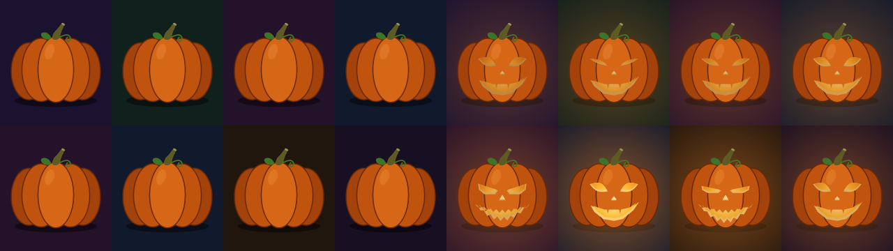
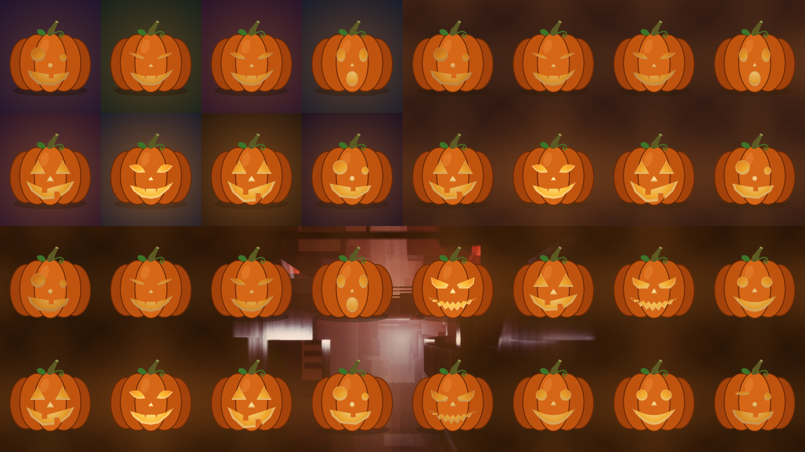

# Pumpkin user guide

Pumpkin is **the Test Card's pumpkin patch, for [Resolume](https://resolume.com) Arena and
Avenue**, as an FFGL source: **SW Pumpkin**, a jack-o'-lantern on every LED tile, each carved with
one of six faces, its candle flickering and its face blinking, winking or chomping in its own time.

The pumpkin is the [Test Card](https://github.com/stoatworks-labs/test-card)'s own: the lantern, the
six faces and how they move, the candles, which face goes on which tile and each tile's night are the
test card's code, ported line for line, and the plugin is checked against the test card itself. So with the same tiles and the same seed you get the same
patch, and on the Wall clock the same flicker, which is handy when a Halloween gig has a test card on
one screen and Resolume on the next. It's also handy when somebody asks whether the wall can do
"something spooky" between the bands, which by late October they always do.


*SW Pumpkin at its defaults at 1280 × 720, 21.6 seconds in: 168-pixel tiles (the test card's
default LED tile), Seed 1, every face. Rendered by `pktest`, the offline harness, rather than
captured from Resolume.*

> **Before you rely on this:** it's at **v0.1.0**, the first release, and early days. Everything
> below was rendered and measured offline by a harness (`pktest`) that drives the plugin's own
> class in a headless GL context on a synthetic clock, and `tools/verify.sh` passes on macOS 26 on an
> Apple M4 Max, on the GPU and again on Apple's software renderer. The checks are against the test
> card itself. Its own TypeScript, run for the purpose, prints its hashes, the face on 450 tiles over
> five seeds and three tile grids, its candles and blinks out to ten years of running, and every
> point of every face at four stages of its expression: the plugin's port agrees with all of it,
> the hashes and faces exactly and the rest to 1e-16. The test card's own painter, run in Chrome,
> drew seven reference pictures; the plugin's are a mean of 0.24 to 0.81 code values from them,
> with the bigger differences on edges, where no two renderers agree, and flat areas within 4 code
> values bar a handful of pixels. Fourteen models broken on purpose and eight one-character changes
> to the shipped code are all caught, and all 16 controls changed the picture in the harness's
> sweep. The only host it's been run in on a Mac is the fleet's own test host, `oxbow`, which loads
> it as `SW Pumpkin` (`PK01`, a source) and renders 120 frames through it, so it has **never been
> loaded into Resolume on macOS**.
>
> **On Windows** the fleet's Arena gate passed (9 of 9): it loads, registers and renders in Resolume Arena 7.27.1 on win-lab under software rendering (no GPU), every control as declared, and 14 of its 16 controls changed a still picture there (Clock and Expressions act on a moving one, so a still can't show them).
>
> The comparison with the test card is with its pictures as Chrome's software canvas paints them;
> a test card on a GPU canvas may differ by a code value or so at edges. Try it on a spare layer
> before you put it in a show.
>
> This codebase was created with AI assistance, directed and reviewed by a human author.

---

## Installing

The download has one plugin in it, **SW Pumpkin**, as `Pumpkin.bundle` on macOS and `Pumpkin.dll`
on Windows. Get it from the
[`v0.1.0` release on GitHub](https://github.com/stoatworks-labs/pumpkin/releases/tag/v0.1.0) or the
[project page](https://stoatworks-labs.com/software/pumpkin/), drop it into Resolume's effects folder
and restart Resolume:

```
macOS    ~/Documents/Resolume Arena/Extra Effects/
Windows  %USERPROFILE%\Documents\Resolume Arena\Extra Effects\
```

Avenue uses the same layout under its own folder name. SW Pumpkin shows up among the sources. If you
use [Burrow](https://stoatworks-labs.com/software/burrow/), my installer for the whole fleet, it'll
put it in the right folder for you.

The macOS download is a universal build (Apple silicon and Intel), as a `.dmg` or a `.zip`. It's
**Developer ID-signed and notarised** by the release pipeline after publication, so the bundle just
loads. If macOS refuses a download, it's from before the signing, so download it again. The Windows
download is an x64 installer (`-setup.exe`) or a `.zip`. It isn't code-signed, so the installer trips
SmartScreen once: **More info** → **Run anyway**.

---

## Start here

1. Put **SW Pumpkin** in a clip slot and trigger it. You get the test card's pumpkin patch: a
   168-pixel tile grid from the top left, a pumpkin on every tile, each tile its own shade of night.
2. Watch one pumpkin for a few seconds. Its candle flickers, and every two and a half to four seconds
   its face does its thing: a blink, a wink, a chomp, a squint, a gasp or a narrowing of the eyes,
   depending on the face.
3. Set **Tile Width** and **Tile Height** to your wall's real tile size in pixels. A pumpkin per
   cabinet makes a good check that the mapping is right, and a better one that the wall's still
   working at 11pm.
4. Change **Seed**. Every tile is dealt again.
5. Untick **Classic**, **Happy**, **Surprised** and **Goofy**. Now it's sly and fierce faces only, and
   the patch looks a good deal less friendly.
6. Set **Background** to *None* and put the layer over a clip. The pumpkins, their glow and their
   shadows sit on your footage.

---

## What it draws

Each tile gets a pumpkin centred in it and sitting on a soft shadow, 80% of the tile's width or as
tall as fits 84% of its height counting the stem, whichever is smaller. Behind the pumpkin, the tile
is its own night: six dark colours, dealt by the tile's column plus twice its row, so neighbours
differ. A carved pumpkin glows: the candlelight comes through the holes, lights the cut flesh round
them and casts an orange glow round it. On *Night* the glow stops at the tile's edge, as on the test
card, where each tile's own colour hides the line; on *Dark* and *None* the neighbours' glows run on
across it, so there's no line to see. A plain pumpkin has no candle and no glow.

**Which face goes where** comes from the tile's place: a hash of the Seed and the position of the
tile's top-left corner. So a tile keeps its face when you resize the output, and moving the grid a
whole tile along changes no pumpkin (only the nights, which are counted from the origin, come round
differently). Tiles hanging off the edge of the frame are drawn as far as they're in it.

**The six faces** are the test card's:

| Face | at rest | its expression |
| --- | --- | --- |
| Classic | triangle eyes, a gap-toothed grin | **chomps**: the jaw drops |
| Fierce | angled eyes, a mouth of zig-zag teeth | **squints**, and the teeth part |
| Happy | round eyes, a wide crescent smile | **blinks** both eyes nearly shut |
| Surprised | tall oval eyes, an O of a mouth | **gasps**: eyes and mouth go wider |
| Sly | cat's eyes, a smirk with fangs | the eyes **narrow to slits** |
| Goofy | one big eye, one small one, a lopsided grin | **winks** the big eye |


*Each face at rest (the first and third rows) and at the height of its expression (the second and
fourth): classic, fierce and happy, then surprised, sly and goofy. Each panel is one 320 × 270 tile
at the moment that face peaks, the same frame with Expressions off and on. Rendered by `pktest`.*

**The candles** are each three flickers added together, at about 1.3, 3.1 and 5.3 times a second,
each one's rate and phase its own, so no two candles move together. A candle's level wanders between
0.45 and 0.99, where a steady one burns at 0.8; it sets how bright the holes, the cut flesh and the
glow are. **The expressions** come round every two and a half to four seconds, again
each pumpkin at its own rate and time, and last about a seventh of that (a third to just over half
a second).

---

## The controls

Resolume shows **Speed** as a slider from 0 to 1. Tile Width, Tile Height, Origin X, Origin Y and
Seed are whole numbers in their own units, the face ticks and Flicker and Expressions are switches,
and Clock and Background are dropdowns.

### The Patch group

**Tile Width** and **Tile Height** (16 to 4096 pixels; default 168, the test card's default LED
tile). The size of one tile, which is one pumpkin. Use your cabinets' size in pixels as they're
mapped in the composition.

**Origin X** and **Origin Y** (−4096 to 4096 pixels; default 0). Where a tile corner falls,
measured from the top left of the source's own frame. The grid repeats from there in both
directions, so any whole number of tiles either way puts the same tiles in the same places.

**Seed** (0 to 9999; default 1). Which face goes on which tile. The same number as the test card's
**Seed** for the pumpkin patch.

### The Faces group

**Classic**, **Fierce**, **Happy**, **Surprised**, **Sly** and **Goofy** (all on by default). The
faces to carve. The patch is dealt from the faces ticked, in that order, so unticking one deals the
whole patch again from the rest: the tiles that had it get one of the others, and a fair share of
the other tiles change too (between a seventh and two fifths of them, depending on which face goes),
just as they do on the test card. Untick all six and the pumpkins are plain: uncarved and unlit,
with no glow.



*Left: every face unticked, so the pumpkins are plain. Right: only Fierce and Sly. Both on 160 × 180
tiles at 640 × 360, 24.65 seconds in. Rendered by `pktest`.*

### The Candles group

**Flicker** (on). Off, every candle burns steady at 0.8, as the test card's do with *Candles
flicker* unticked.

**Expressions** (on). Off, every face stays at rest.

With both off the picture doesn't move at all: it's a still.

**Speed** (0.5, which is the test card's pace). How fast the candles and faces keep time: a quarter
to four times the test card's pace, geometrically, so the middle of the slider is 1×, three-quarters
is 2× and the top 4×. Right at the bottom it's 0 and everything freezes where it is. Changing Speed
changes the pace from where it is; it doesn't jump. Speed only applies to the *Resolume* clock.

**Clock** (*Resolume*). Whose time the candles keep:

- *Resolume*: the clip's time, as Resolume sends it, times Speed. A jump in it (a scrub, or a
  retrigger that sends it backwards, or anything more than a second forwards) passes no time, so the
  candles carry on rather than lurching.
- *Wall*: this computer's clock, in seconds since the start of 2026 (UTC), which is the clock the
  test card's live output keeps when **Endless, for live output** is ticked. So a pumpkin in
  Resolume flickers and blinks in step with the same pumpkin on a test card window, on any two
  machines whose clocks agree. Speed doesn't apply.

### The Look group

**Background** (*Night*). What's behind the pumpkins:

- *Night*: each tile its own night sky, as the test card draws them.
- *Dark*: the test card's page colour on every tile, and the glows run on across the tiles' edges,
  so the grid disappears.
- *None*: transparent, so you get the pumpkins, their glow and their shadows over whatever's below.
  The output is premultiplied, as Resolume expects of a source.



*The same patch three ways: Night (top left), Dark (top right) and None over a frame of Resolume's
FogAndDust_3 demo clip (bottom, 1280 × 360). 160 × 180 tiles, 24.65 seconds in. Rendered by
`pktest`; the bottom panel's clip was laid underneath afterwards, as a layer below would be.*

On *None* a carved patch lights the whole clip a little: the glows overlap, so nothing between the
pumpkins is quite clear (on these tiles, never less than about 15% orange). For a clean overlay
untick every face: plain pumpkins have no glow, and leave everything but themselves and their
shadows clear.

### About

The last group, **About**, has the plugin's name, version, licence and maker, and buttons that open
this guide, the project page, the source on GitHub and the support page in your browser.

---

## Recipes

**A pumpkin per cabinet.** Set Tile Width and Tile Height to the cabinets' size in pixels as they're
mapped in the composition, and Origin X and Origin Y to where the first cabinet's top-left corner
sits. With 192-pixel cabinets and the wall starting 320 pixels in from the left, Origin X is 320
(or 128, or −64: any whole number of tiles either way gives the same pumpkins). A cabinet that shows half a pumpkin is a mapping
that's half a cabinet out.

**The same patch as the test card.** Use the same tile size and Seed as the test card's pumpkin
patch, and set Origin X and Origin Y to where that output's tiles start in the composition. The test
card only deals this patch on outputs it treats as part of one surface: tick **Carry on across
outputs** there, with the outputs placed in the composition. An output that's its own world mixes
its own number into each tile, so that six identical projectors don't all get the same patch, and
deals a different one from the same seed. The faces then match tile for tile. The nights may not on
a second output, because the test card counts its tiles per output and the plugin counts them across
the whole frame.

**In step with a test card window.** Clock *Wall* here; **Endless, for live output** on the test
card, showing on its live output or preview. Both read the computer's clock, so they agree to as
well as the two clocks do. A test card MP4 loop won't match: a loop fits every flicker to a whole
number of cycles, so its candles run at slightly different rates.

**Over your own footage.** Background *None*, on a layer above the clip with the Alpha blend mode. Plain pumpkins
(every face unticked) for a cleaner look, or carved ones for the glow. A darker clip makes more of
the candlelight.

**A still frame.** Untick Flicker and Expressions: every candle steady at 0.8, every face at rest,
nothing moving. Or set Speed right to the bottom to freeze it wherever it is, flicker, mid-blink and
all.

**A patch that suits the act.** Fierce and Sly only for the metal band; Happy and Goofy for the
children's matinee; nothing ticked if the client thinks carved faces are a bit much.

---

## How it works

- **The port.** The test card's drawing, its timing, its tile hash and its random number generator
  are its TypeScript translated into C++, line for line, and compiled so that it rounds the way
  JavaScript does. The checks run the test card's own code and compare.
- **The drawing** goes up to the graphics card once, as a table of shapes and points. The test card's
  canvas smooths the corners off nearly everything; its rounded shapes are drawn here as true
  ellipses and the rest as short straight pieces, each within 0.1 pixel of the canvas's curve on a
  pumpkin 4096 pixels wide. Every face's points are stored at rest and at the height of its
  expression, and mixed for each tile.
- **The candles** are worked out on the CPU, in double precision, for every tile you can see (and a
  border of one tile round them, whose glows reach in on *Dark* and *None*), each frame; their sines never touch the graphics card. Resolume's clock can run to hundreds of
  millions of milliseconds, so time is taken frame to frame, never held in a single-precision
  number.
- **The picture** is one pass. Each pixel works out which tile it's in and paints that tile's
  pumpkin, in the test card's order: the night, the shadow, the glow, the body, the cut flesh, the
  candlelit holes. On *Dark* and *None* the glow is its own tile's and its eight neighbours'.

---

## Performance

Measured by the offline harness (`pktest --bench`) on an Apple M4 Max shared with other work, the
median frame:

| | 168 px tiles (the default) | 16 px tiles (the smallest) | one tile |
| --- | --- | --- | --- |
| 1280×720 | 0.44 ms | 1.34 ms | 0.22 ms |
| 1920×1080 | 0.64 ms | 2.68 ms | 0.34 ms |
| 3840×2160 | 1.60 ms | 9.83 ms | 1.08 ms |

At the defaults that's 3–10% of a 60 fps frame. The candles are worked out tile by tile on the CPU,
so tiny tiles cost more: 16-pixel tiles at 4K are 32,400 pumpkins, which is more pumpkin than most
people need. Nothing was timed inside Resolume, and nothing was timed on Windows.

---

## If it looks wrong

**Nothing appears, or the clip is black.** That's what a shader that won't compile looks like. The
actual error is in the log (see below).

**It isn't in the browser.** Check the folder under *Installing*, and that Resolume was restarted.

**The pumpkins don't sit on the cabinets.** Tile Width and Tile Height are in the source's own
pixels, and Origin X and Origin Y are from the top left of its own frame. If the clip isn't the
composition's size, or the layer is scaled or moved, or the output mapping scales the slice, the
grid moves with it. A pumpkin cut in half at a cabinet's edge means the origin is half a tile out.

**It's a different patch from the test card's.** Check the Seed and the tile size, then the origin
(the faces come from the tiles' positions). If those match, the test card output is probably its own
world rather than part of a spanned surface: see *The same patch as the test card*. Pumpkin only
does uniform tiles, so it can't match a test card using an imported cabinet map.

**The flicker isn't in step with the test card.** Clock has to be *Wall* here, **Endless, for live
output** ticked there, and the two computers' clocks set from the network. A clock a second out is
a candle a second out. Speed has no effect on *Wall*.

**The clip looks orange on None.** That's the candles: the glows overlap and tint everything
between the pumpkins a little. Untick every face for plain pumpkins, which have no glow, or put the
layer at a lower opacity.

**A face never does anything.** It does, but briefly: about a seventh of the time. Watch a few
seconds, or check Expressions is on and Speed isn't at the bottom.

**The log** records the GL vendor, renderer and version at load, the size of the drawing it
uploaded, a shader that failed to compile and textures that couldn't be allocated:

```
macOS    ~/Library/Logs/pumpkin/pumpkin.YYYY-MM-DD.log
Windows  %LOCALAPPDATA%\pumpkin\logs\pumpkin.YYYY-MM-DD.log
```

---

## Known limits

- **Never loaded into Resolume on macOS.** Everything was compiled, rendered and measured offline
  against the plugin's own class in a headless GL context, plus a load in `oxbow`. On Windows it has
  only been loaded by the fleet's Arena gate, on software rendering.
- **Uniform tiles only.** The test card can also use a cabinet map imported from Pixel Peeker;
  Pumpkin can't.
- **On *None* a carved patch tints the whole clip**, and there's no control for how strongly the
  candles glow.
- **The test card's patch only on a span**, as described above.
- **No beat sync.** The candles and faces keep their own time, not the music's. No presets, and no
  OpenFX version.
- **Only ever run on an Apple M4 Max** on a Mac, although the macOS build contains an Intel slice.
  The comparison with the test card's pictures would have to be measured again on any other
  graphics card.

---

## Links

- Project page: [stoatworks-labs.com/software/pumpkin](https://stoatworks-labs.com/software/pumpkin/)
- Source: [github.com/stoatworks-labs/pumpkin](https://github.com/stoatworks-labs/pumpkin)
- User guide: [stoatworks-labs.com/software/pumpkin/guide](https://stoatworks-labs.com/software/pumpkin/guide/)
- The Test Card: [test-card.stoatworks-labs.com](https://test-card.stoatworks-labs.com)

## Reporting something

If something's wrong, shout at
[github.com/stoatworks-labs/pumpkin/issues](https://github.com/stoatworks-labs/pumpkin/issues).
A screenshot, the tile size, origin and Seed, which faces were ticked, the Clock and Background, and
the composition's resolution and frame rate are usually enough. If it showed nothing, attach the
log.

The pumpkin patch is the Test Card's (MIT, Stoatworks Labs), ported line for line.
